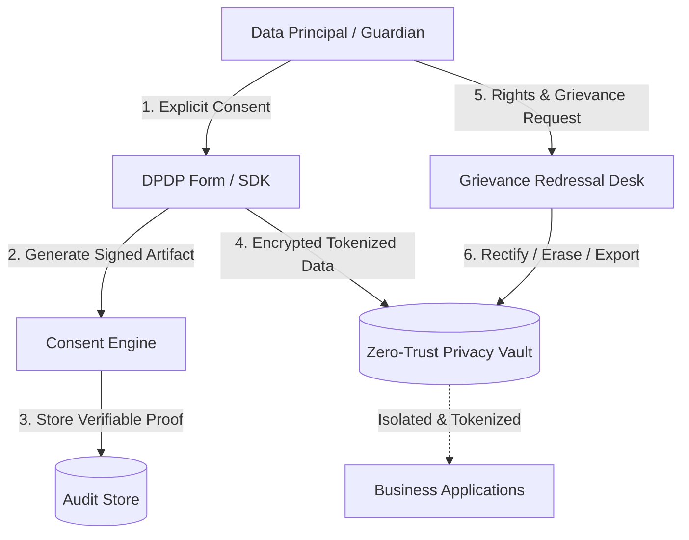

`dpdpcomply` provides a multi-tenant, defensible compliance infrastructure designed specifically for Data Fiduciaries managing personal and sensitive digital personal data under the **Digital Personal Data Protection (DPDP) Act, 2023** and notified **DPDP Rules, 2025**.

## Statutory Roles & Responsibilities

The platform cleanly maps organizational workflows to statutory roles defined in the Act:

<Columns cols={2}>
  <Card title="Data Fiduciary" icon="building">
    The entity (such as an educational institution, school group, or enterprise) that determines the purpose and means of processing personal data.
  </Card>
  <Card title="Data Principal" icon="user">
    The individual to whom the personal data relates. Where the principal is a child or person with a disability, rights are exercisable by their lawful guardian.
  </Card>
  <Card title="Consent Manager" icon="handshake">
    Interoperable entities registered under Rule 4 that act as a single point of contact to enable Data Principals to give, manage, review, and withdraw consent.
  </Card>
  <Card title="Data Protection Officer (DPO)" icon="user-shield">
    The designated statutory authority responsible for compliance oversight, grievance redressal, and Data Protection Board communications.
  </Card>
</Columns>

---

## Architectural Principles

### 1. Separation of Consent and Personal Data
Personal data is never stored alongside plain text consent logs. Consents are stored as immutable, cryptographically signed **Consent Artifacts**, while sensitive identifiers are tokenized and deposited into isolated, tenant-partitioned **Privacy Vaults**.

### 2. Affirmative, Unbundled Notices (Section 5)
Every request for personal data must be preceded or accompanied by a clear, unbundled notice available in English and any of the **22 languages specified in the Eighth Schedule** to the Constitution of India.

### 3. Statutory Timelines & Audit Defensibility
- **Grievance Redressal**: Section 12 mandates resolution within published timelines (maximum 72 hours SLA tracked inside the platform).
- **Incident Intimation**: Section 8(6) and CERT-In Directions 2022 enforce a **6-hour statutory reporting countdown** from detection to statutory intimation.
- **Board-Ready Audit Packs**: Export cryptographically verifiable proof of consent and processing logs ready for Data Protection Board inquiries.
