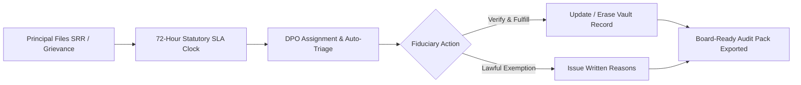

Under Section 11 and Section 12 of the DPDP Act, Data Principals possess legally enforceable rights regarding their personal data, including the right to access summaries, correct inaccurate data, erase data upon purpose fulfillment, and register grievances with Data Fiduciaries.

## Subject Rights Requests (SRR)

The platform automates the statutory intake and execution of four primary rights:

<Columns cols={2}>
  <Card title="Right to Access (Section 11(1))" icon="eye">
    Provides a summary of personal data being processed, processing activities undertaken, and identities of third-party Data Fiduciaries with whom data was shared.
  </Card>
  <Card title="Right to Correction (Section 12(1))" icon="pen-to-square">
    Allows Data Principals to request correction of inaccurate data, completion of incomplete fields, or updating of obsolete details.
  </Card>
  <Card title="Right to Erasure (Section 12(2))" icon="trash">
    Executes deletion of personal data when purpose retention expires or consent is withdrawn, unless processing is required by another applicable law.
  </Card>
  <Card title="Right of Grievance (Section 13)" icon="life-ring">
    Provides an easily accessible mechanism to file complaints regarding privacy obligations, with automated SLA tracking.
  </Card>
</Columns>

---

## Statutory SLA & Escalation Pipeline

<Note>
  Under DPDP Rules 2025, Data Fiduciaries must resolve grievances before a Data Principal can escalate the matter to the Data Protection Board of India. The platform enforces an internal **72-hour operational SLA** to prevent statutory defaults.
</Note>

## Board-Ready Audit Pack

When requested by compliance auditors or the Data Protection Board, the platform can bundle a complete, digitally signed zip package containing:
- Verifiable Consent Artifacts with timestamp proofs.
- Complete notice versions presented to the Data Principal.
- Chronological logs of all vault read, write, update, and tokenization events.
- Signed record of grievance handling, communications, and final resolution.
